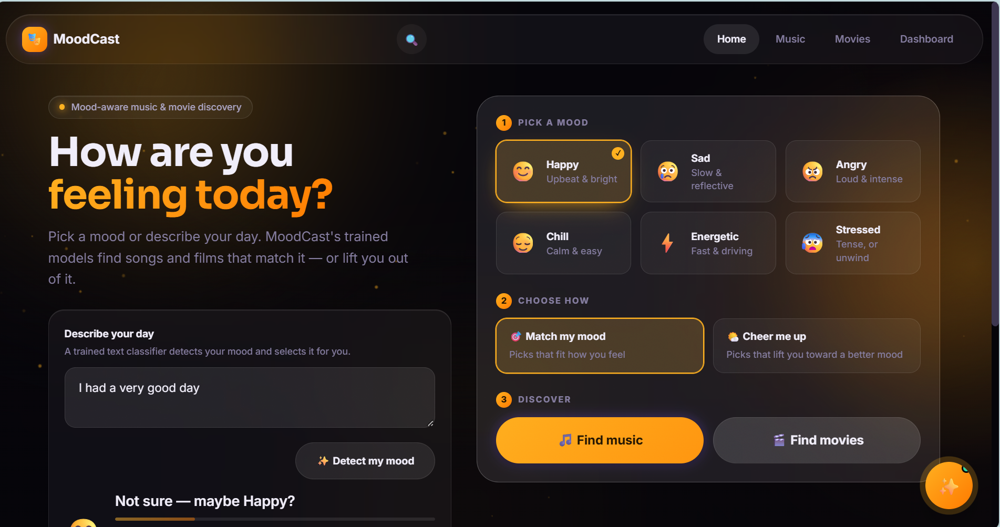
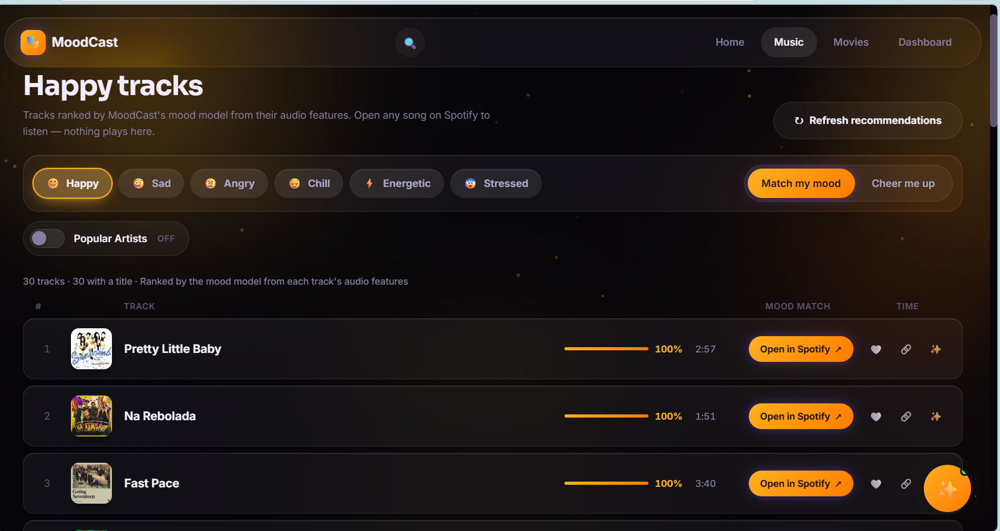
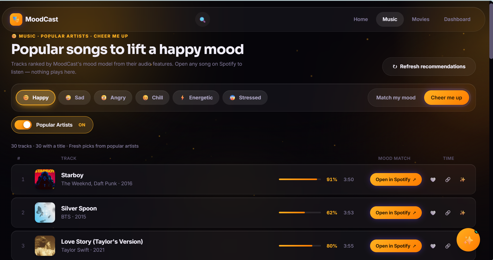
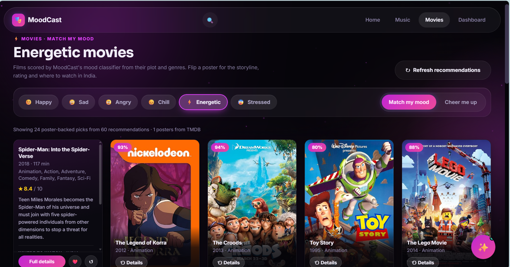
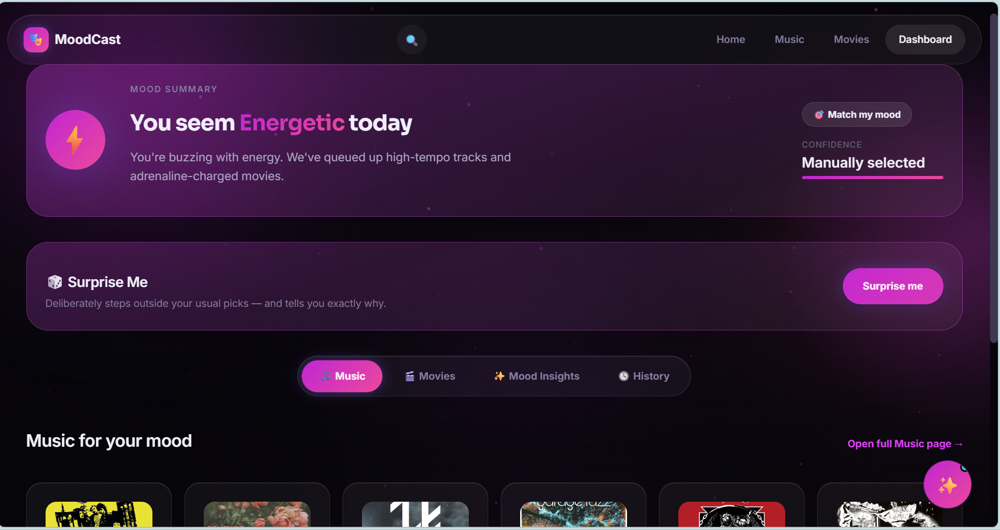

# MoodCast — mood-based music and movie recommendations

MoodCast is a Flask web app that recommends music and movies for a mood. You
pick one of six moods, or describe how you feel in a sentence, then choose
"Match my mood" or "Cheer me up". It is a portfolio and learning project. It
is not deployed anywhere and has no commercial clearance for any of the data
it can use.

The ML is implemented from scratch on numpy and pandas (`src/ml/`: softmax
regression, Gaussian Naive Bayes, K-Means and TF-IDF), with no scikit-learn.

**Tech stack**
- **Backend:** Python 3.13 and Flask (Jinja templates and a JSON API).
- **Data and ML:** pandas and NumPy. The models are implemented from scratch
  in `src/ml/` (no scikit-learn):
  - a TF-IDF + softmax-regression text mood classifier;
  - a softmax-regression audio-feature mood classifier.
- **Frontend:** HTML, CSS and plain JavaScript (no framework).
- **External services:** `requests` for TMDB and Spotify oEmbed lookups.
- **Configuration:** `python-dotenv`.
- **Tests:** pytest, plus Node.js's built-in test runner for the JavaScript.

> **Datasets are not included.** This repository ships the code, tests,
> evaluation reports and the small text-mood model. The music catalog, the
> movie dataset and the models derived from them are not redistributed
> because their redistribution rights are unverified (see [DATA.md](DATA.md)).
> The app starts without them. Features that need a missing dataset say so
> instead of failing.

## What works without any local data

| Feature | Without local data | What it needs |
|---|---|---|
| Pages (home, music, movies, dashboard) | Render | — |
| Text mood detection (`/api/detect-mood`) | Works (model included) | — |
| Music recommendations | Unavailable: the API answers `503` with an explanation | The 278k catalog, built locally ([below](#music-catalog-optional)) |
| Popular Artists mode | Says its dataset isn't prepared | Its own Kaggle dataset **and** the music catalog/classifier ([below](#popular-artists-optional)) |
| Track titles and covers | Unavailable: no tracks are shown without the music catalog | The music catalog first. Titles and covers then come from Spotify's public oEmbed endpoint (network access). Optional local metadata adds artists and search ([METADATA.md](METADATA.md)) |
| Movie recommendations and movie search | Unavailable (`503`); search returns no movie results | `data/movies_final.csv`, which is **not distributed and cannot be rebuilt from this repository** ([below](#movies)) |
| Movie posters fallback and where to watch (India) | Unavailable | The movie dataset plus a `TMDB_API_KEY` |

## Screenshots

These were captured from the local setup, where the optional
datasets were supplied locally: the music catalog, local metadata, the
Popular Artists dataset and the movie data. A fresh clone shows the
"unavailable" messages described above instead. Album covers and movie
posters belong to their respective rights holders.

<table>
  <tr>
    <td width="50%" valign="top">
      <br>
      <sub><b>Home.</b> Pick one of six moods or describe your day. A low-confidence text result is shown as a guess ("Not sure — maybe Happy?").</sub>
    </td>
    <td width="50%" valign="top">
      <br>
      <sub><b>Music.</b> Happy · Match my mood, ranked from audio features. Each track opens on Spotify; nothing plays in the app.</sub>
    </td>
  </tr>
  <tr>
    <td width="50%" valign="top">
      <br>
      <sub><b>Popular Artists.</b> The same page with Popular Artists on (Cheer me up), drawing from its separate local dataset.</sub>
    </td>
    <td width="50%" valign="top">
      <br>
      <sub><b>Movies.</b> Energetic · Match my mood. Only titles with a working poster are shown; a flipped card shows the storyline and rating.</sub>
    </td>
  </tr>
  <tr>
    <td width="50%" valign="top">
      <br>
      <sub><b>Dashboard.</b> Mood summary with music, movies, mood insights and history tabs.</sub>
    </td>
    <td width="50%"></td>
  </tr>
</table>

## Requirements

- Python 3.13. Dependencies are pinned in `requirements.txt` (Flask, pandas,
  numpy, requests, python-dotenv).
- Node.js is needed only for the JavaScript tests (`node --check` and Node's
  built-in test runner). It was developed with Node 22. Without Node, those
  tests are skipped.
- Git is needed for a few repository checks in the test suite (they skip
  outside a Git checkout).

## Install and run

```bash
python -m pip install -r requirements.txt
python flask_app.py
```

Then open http://127.0.0.1:5000. On Windows, `start_moodcast.bat` does the
same: it installs the requirements, then starts the server.

Configuration is optional. Copy `.env.example` to `.env` (gitignored) and set
what you need:

| Variable | Purpose |
|---|---|
| `TMDB_API_KEY` | Movie poster fallback and India watch providers (TMDB / JustWatch). Only useful with the movie dataset |
| `FLASK_HOST`, `FLASK_PORT`, `FLASK_DEBUG`, `LOG_LEVEL` | Server settings (default `127.0.0.1:5000`, debug off) |
| `MOODCAST_ARTIST_PRIORITY` | `1` turns the preferred-artist layer on, `0` forces it off ([below](#preferred-artists)) |
| `MOODCAST_SPOTIFY_OEMBED` | `0` disables the Spotify oEmbed title/cover lookup |

Variables already set in the environment take precedence over `.env`.
Never commit real keys.

## Optional local data

Each dataset below is downloaded or built on your machine and is gitignored.
The licensing details and caveats for each are in [DATA.md](DATA.md). The
source datasets are hosted on Kaggle, and downloading them may require a
Kaggle account and signing in.

### Music catalog (optional)

Music recommendations need `data/music_catalog_278k.csv` and
`models/music_mood_classifier_278k.pkl`. Both are built offline from the
"278k Emotion Labeled Spotify Songs" dataset (Moodify, Kaggle, CC BY 4.0):

1. Download the dataset from
   https://www.kaggle.com/datasets/abdullahorzan/moodify-dataset (this project
   used Kaggle version 2, 2023-05-31). Place `278k_labelled_uri.csv` at
   `data/music_dataset2/278k_labelled_uri.csv`.
2. Optional check: the file this project used has SHA-256
   `0b7c864e7de8d16eaf2c284af5ba7c3bce77a0e6f72a275b774e361bc40e1b02`.
   Whether a fresh Kaggle download has exactly these bytes has not been
   verified.
3. Run `python train_music_278k.py`. It needs no network and no Spotify
   access.

With that source file, the rebuild was verified to reproduce the catalog
(SHA-256 `a261afee…9a6a`) and classifier (`09b653bf…40d1`) recorded in
`models/*.json`, so the hash-pinned evaluation tests then run and pass. The
script also rewrites the tracked `models/music_mood_classifier_278k_eval.json`:
its coverage figures reflect the current recommender, and a legacy-comparison
section is dropped. Run `git checkout -- models/music_mood_classifier_278k_eval.json`
if you want to keep the published report.

### Popular Artists (optional)

The Music page's Popular Artists switch uses its own local dataset, which is
not redistributed. It also needs the music catalog and classifier above,
because its moods come from the same classifier.

```bash
python prepare_popular_artists.py --source path/to/spotify_tracks.csv   # or the Kaggle .zip
python prepare_popular_artists.py --download                            # opt-in: fetches version 2 from Kaggle
```

The input must match a pinned SHA-256, or nothing is written. If `--download`
can't fetch the file (for example because Kaggle requires signing in), the
script stops without writing anything. In that case, download the file
manually and use `--source`. Restart the app afterwards. See [DATA.md](DATA.md#popular-artists-dataset).

### Local music metadata (optional)

`python build_music_metadata.py` adds titles, artists and release years for
the catalog tracks found in a separate Kaggle dataset (about 16% of the
catalog). It also enables song and artist search. It needs the music catalog.
See [METADATA.md](METADATA.md).

### Movies

Movie recommendations read `data/movies_final.csv`. That file was derived
from a movie dataset whose source and licence are not documented, so it is
not distributed. This repository cannot rebuild it: `build_tmdb_dataset.py`
writes a different schema and is not a verified replacement. To use the movie
features you would need to supply your own compatible dataset (columns used:
`title`, `genres`, `overview`, `rating`, `popularity`, `release_year`,
`poster_path`, `runtime_min` and the `proba_<mood>` columns written by
`python train_all_models.py`). That path has not been tested.

## How it works

### Six moods

Happy, sad, angry, chill, energetic and stressed (`src/config.py`). Each mood
maps to target moods for "Match my mood" and for "Cheer me up".

### Text mood detection

`src/mood_utils.py` and `src/ml_inference.py` run text through a TF-IDF and
softmax-regression classifier. The classifier is trained on about 1,500 mostly
template-generated sentences (`data/text_mood_dataset.csv`, generated by
`train_all_models.py`). Answers below 0.30 probability, or with no word the
model knows, are returned as an *uncertain* guess and shown that way. A
keyword heuristic is used only if the model file is missing.

Recorded results (`models/text_mood_classifier_eval.json`):
- 95.4% test accuracy on the template data (in-distribution, so optimistic).
- 15 of 18 (83%) on hand-written held-out sentences.
- `python evaluate_text_mood.py --blind` gets 30 of 36 right.

It has not been validated on real user text.

### Music recommendation pipeline

1. `train_music_278k.py` builds the catalog from the 278k dataset. It keeps
   the dataset's four labels (sad, happy, energetic, calm) and adds
   probabilities from a 4-class audio-feature classifier.
   - The classifier's agreement with the dataset's own labels is 83.5% on a
     held-out split (5-fold CV 83.5% ± 0.1%). This measures agreement with
     the labels, not listening quality.
   - Angry and stressed have no dataset label, so they use percentile
     feature rules. Stressed is experimental.
2. `src/recommend.py` gives each target mood a weight-proportional share of
   the list.
   - **Single-label requests** (for example happy in "Match my mood") use
     feature-cell selection. The label's tracks are split into 30
     equal-count cells along the two main directions of their audio
     features, and the list takes one weighted pick from the most confident
     tracks of each cell. This spreads the list across the feature space
     instead of clustering at its most confident extreme.
   - **Calm-only lists** also exclude speech-like tracks (speechiness > 0.66).
   - **Other requests** use a weighted sample from each target's top
     candidates (20 × share).
   - Popularity plays no part in the ranking.
3. Results are enriched only for display: titles and covers come from oEmbed
   or the optional metadata. This step never changes ranking or membership.

The evaluation scripts (`evaluate_music_*.py`) and their aggregate reports in
`models/*.json` document how this design was chosen. Their limits are listed
in [Evaluation limitations](#evaluation-limitations).

### Popular Artists

This is a separate mode with its own dataset and pipeline
(`src/popular_artists.py`), independent of the 278k ranking.
- **Songs:** up to 30 songs by 60 curated international, K-pop and Indian
  artists (`config/popular_artists.json`), at most 2 per artist. They follow
  the selected mood and mode.
- **Moods:** predicted by the music classifier (probability ≥ 0.6) and the
  recorded angry/stressed rules. They have not been validated by people.
- **Short lists:** some moods have few eligible tracks, and lists say so when
  they run short.

### Preferred artists

`src/artist_priority.py` is optional and **off by default**. It may swap up
to 15% of a music list for tracks by artists in `config/artist_priority.json`
(at most 2 per artist). It does this only when the swapped-in track has the
same mood target and the model scores it at least as relevant. It needs the
local metadata to identify artists.

### Movie recommendations and providers

Movies are ranked by a TF-IDF movie mood classifier's probability for the
target mood, blended with rating and popularity (0.65 / 0.20 / 0.15). The
classifier uses plot and genre text. The classifier and its data are not
distributed; `models/movie_mood_classifier_eval.json` keeps its recorded
metrics.

With a `TMDB_API_KEY`, `src/movie_details.py` looks titles up on TMDB, by IMDb
ID or by exact title + year. It adds a fallback poster and where-to-watch
options for India (JustWatch data via TMDB), and it says when availability
couldn't be verified.

## Tests

```bash
python -m pip install -r requirements-dev.txt
python -m pytest
```

The JavaScript checks (`node --check` on every script and the Node unit tests
in `tests/js/`) run inside pytest when `node` is on `PATH`.

Tests that need data the repository doesn't ship skip with the reason
(`tests/local_data.py`). Examples: the music catalog or classifier, the movie
dataset, local metadata, the Popular Artists dataset, a Git checkout, or the
listening-pilot baseline commit. With the files present, those tests run
unchanged. Data-independent tests always run, including the honest-`503`
checks for missing datasets.

## Project structure

```
flask_app.py                 Flask app and JSON API
src/
  config.py                  Moods, mood→target maps, paths, .env loading
  data_loader.py             Loads datasets; missing ones raise DatasetUnavailable (→ 503)
  recommend.py               Music and movie ranking
  music_pipeline.py          278k catalog build, classifier, derived moods
  music_evaluation.py        Recommendation-list metrics
  ml/                        From-scratch ML (softmax regression, Naive Bayes, K-Means, TF-IDF)
  ml_inference.py, mood_utils.py   Text mood detection
  popular_artists.py         Popular Artists mode
  artist_priority.py         Optional preferred-artist layer
  movie_details.py, tmdb_client.py Movie details via TMDB
  spotify_oembed.py          Track titles/covers via Spotify oEmbed
  music_metadata.py          Optional local metadata
templates/, static/          Frontend (plain HTML/CSS/JS)
tests/                       pytest suite; tests/js/ Node tests and page harnesses
models/                      Text model + aggregate evaluation reports (*.json)
evaluation/                  Listening-pilot protocol, blank rating templates, exploratory write-up
train_music_278k.py          Builds the music catalog + classifier
train_all_models.py          Text model (--text-only) and the movie model
prepare_popular_artists.py, build_music_metadata.py   Optional local datasets
evaluate_*.py                Offline evaluation scripts
```

## Evaluation limitations

- **Offline only.** Recommendation quality was judged against the dataset's
  model-generated mood labels and audio-feature diversity proxies, not
  against human relevance judgments.
- **One listener.** A blinded listening pilot was prepared, but only one
  listener rated 20 tracks. The planned comparison could not be estimated
  (`evaluation/listening_pilot_2l3/single_listener_exploratory_results.md`).
  The pilot preparation scripts read a baseline from this project's earlier
  Git history, so they cannot be re-run from a repository that doesn't
  contain that commit.
- **Diversity.** Single-target diversity remains an open issue (see the
  reports in `models/`).
- **Stressed** uses an experimental rule.
- **Metadata coverage.** The optional metadata covers about 16% of catalog
  tracks.

## License

The source code is under the MIT License ([LICENSE](LICENSE)). The MIT
License does **not** cover any dataset, Spotify content, third-party metadata,
artwork, or models trained on third-party data. Their sources, licences and
unresolved questions are documented separately in [DATA.md](DATA.md) and
[METADATA.md](METADATA.md).
